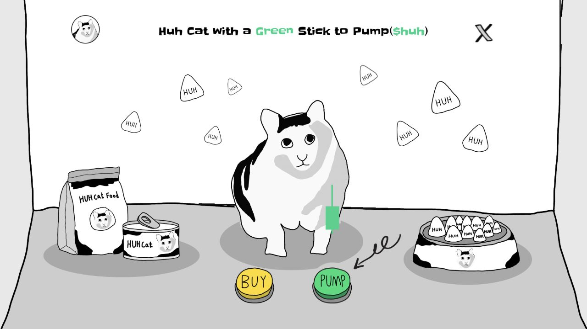

# Huh Cat — Interactive Playground

Huh Cat 是一个以原创手绘角色为核心的互动网页设计作品，将插画、动画反馈、声音与前端交互整合为可循环体验的单页网站。

[在线体验：huh-cat.com](https://huh-cat.com) · [项目介绍](https://wide-nest-95c.notion.site/Huh-Cat-PUMP-3f815452b8448194b0fecd7fece758ca)



## 交互设计

- **喂食**：点击漂浮的猫粮，触发飞向猫咪的动画；每份猫粮在一轮中仅可喂食一次。
- **PUMP**：按下按钮，触发猫咪动画、音效与绿色图形的联动反馈。再次点击可重新播放动画。
- **完成一轮**：喂完全部 8 份猫粮后，PUMP 触发强化动画和另一段音效。动画结束后自动复位，开始下一轮。

桌面与移动端分别适配，保留统一的手绘视觉语言。页面下方的图表和角色插画延续首页风格。

## 设计与实现

作者负责原创插画、UI 与原站设计开发，当前实现结合 AI 辅助完成重建、调试与部署。作品重点展示视觉设计到前端实现的衔接，以及动画、声音和状态反馈构成的完整交互流程。

## 技术与运行

React 19 · TypeScript · CSS · vinext / Vite · Cloudflare Workers。

使用 Web Audio API 预解码音效，React 状态与 CSS 动画管理交互。要求 Node.js >=22.13.0。

```bash
npm ci
npm run dev
```

检查与生产构建：

```bash
npm test
npm run lint
npm run build
```

仓库包含前端源码、样式、构建配置、测试和首页预览图。运行所需的图片、GIF、字体与音频尚未全部纳入仓库，完整体验请访问线上网站。

## 项目声明

本项目仅用于网页设计与前端交互展示，没有任何真实 CA，不提供代币发行、交易或钱包功能，与市场上的任何 Meme 币项目无关。

页面中的品牌名称属于视觉设计内容，不代表相关机构的赞助或背书。原创插画与 UI 的权利归作者所有；仓库公开供查看与学习，不额外授予插画、音频或字体的再分发许可。
